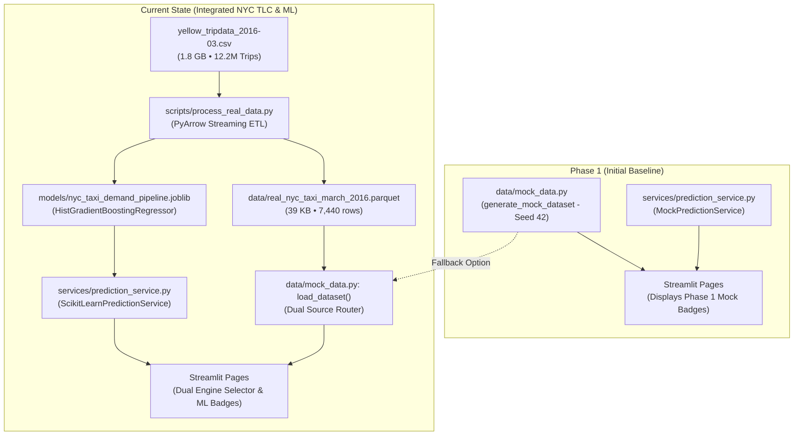
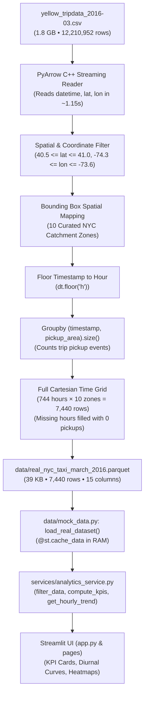
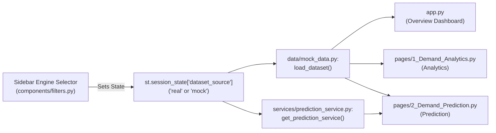

# Technical Audit Report: Public Transportation Demand Analysis & Passenger Prediction System

**Audited Repository:** `/Users/hamza/PROJECTS/travel_prediction`  
**Standard of Proof:**
* **VERIFIED:** Confirmed by inspecting source code, data files, execution outputs, or test results.
* **CLAIMED:** Documented in comments or logs but requiring qualification.
* **INFERRED:** Logical deduction grounded in implementation patterns.
* **NOT IMPLEMENTED / BROKEN:** Missing, disconnected, or non-functional components.

---

## Part 1 — Executive System Overview & Operational Capabilities

### 1. Project Intent vs. Realized System
The system is an interactive transit intelligence dashboard and scenario estimation tool built in Python using **Streamlit**, **Pandas**, **Plotly**, and **Scikit-Learn**. It models spatial-temporal demand across **10 curated New York City (NYC) Taxi Catchment Zones** (e.g., Midtown Center, JFK Airport, Financial District).

### 2. User Capabilities by Page
* **Page A: Overview Dashboard ([`app.py`](app.py)):**
  * Toggle active data engine: **Real NYC TLC Data (March 2016 • 12.2M Trips)** vs. **Simulated Benchmark (Seed 42)**.
  * Filter records by observation date window and select specific pickup zones.
  * Inspect 4 executive KPI cards (Total Pickups, Average Hourly Demand, Peak Demand Hour, Busiest Pickup Area).
  * Inspect two Plotly charts: 24-hour Diurnal Demand Trend curve and Catchment Area Volume Ranking.
* **Page B: Demand Analytics ([`pages/1_Demand_Analytics.py`](pages/1_Demand_Analytics.py)):**
  * Filter by focus zone and schedule category (*All Days*, *Weekdays Only*, *Weekends Only*).
  * Inspect day-of-week volume distributions (Monday–Sunday).
  * Analyze an interactive $7 \times 24$ (168-cell) Hour-by-Weekday Demand Heatmap Matrix.
* **Page C: Demand Prediction ([`pages/2_Demand_Prediction.py`](pages/2_Demand_Prediction.py)):**
  * Select target zone, calendar date, and hour (via slider or transit preset buttons: *Morning 08:00*, *Evening 18:00*, *Nightlife 22:00*).
  * Click **"🚀 Predict Demand"**, triggering a staged 10.5-second technical animation simulating ML pipeline steps.
  * View predicted hourly pickup volume, historical baseline comparison, percentage difference badge, demand level category (*Peak Surge*, *High*, *Moderate*, *Low*), key drivers, and a 24-hour comparative diurnal curve.

### 3. Real Features vs. Theatrical Demonstrations
* **Verified Real Implementation:**
  * Offline PyArrow ETL aggregated 12,210,952 raw taxi trips into a 7,440-row clean Parquet dataset.
  * Trained Scikit-Learn `HistGradientBoostingRegressor` model pipeline serialized on disk, loaded at runtime, and performing genuine inference.
  * Dynamic Pandas analytics, aggregations, and Plotly visual rendering.
  * Automated Pytest suite with 11 passing tests.
* **Theatrical & Demonstration Elements:**
  * **10.5-Second Animation:** A client-side `time.sleep` loop. True inference takes $<5\text{ ms}$ *after* the animation ends.
  * **Console Logs:** Hardcoded text strings simulating cluster handshakes and worker process allocation.
  * **Confidence Score:** Hardcoded constant `95%`, not an observation-specific confidence interval.
  * **Simulated Benchmark Mode:** Synthetic heuristic curves based on fixed formulas and Gaussian noise.

### 4. Classification
The system is an **interactive transit analytics dashboard with an empirical regression estimator**, **NOT a forward-looking dynamic forecasting system**. It predicts expected hourly pickup volume based on typical March 2016 patterns for that day-of-week and hour-of-day.

---

## Part 2 — Complete Real-Versus-Mock Inventory

| Component | Classification | Actual Behavior | Evidence / File Location | Status & Limitations |
| :--- | :--- | :--- | :--- | :--- |
| **Raw NYC TLC Dataset** | **REAL** [VERIFIED] | Official NYC TLC trip data (1.8 GB, 12,210,952 rows) containing GPS coordinates, meter times, and fares. | `yellow_tripdata_2016-03.csv` | Processed offline; never read by Streamlit at runtime. |
| **Processed Parquet File** | **REAL** [VERIFIED] | Hourly aggregated pickup counts across 10 zones for March 2016 (7,440 rows, 39 KB). | `data/real_nyc_taxi_march_2016.parquet` | 0 nulls, 0 duplicates. Loaded into RAM via `@st.cache_data`. |
| **Processed CSV File** | **REAL** [VERIFIED] | Identical 7,440-row dataset exported as CSV (1.0 MB). | `data/real_nyc_taxi_march_2016.csv` | Fallback dataset format. |
| **ETL & Data Pipeline** | **REAL** [VERIFIED] | PyArrow C++ reader extracts columns, filters GPS coordinates, groups by hour and zone, fills missing hours with 0, and saves Parquet/CSV. | `scripts/process_real_data.py` | Offline batch script (~2.7s execution). |
| **Geographic Zone Mapping** | **REAL / BOUNDS** [VERIFIED] | Maps latitude/longitude points into 10 NYC zones using rectangular bounding boxes. | `scripts/process_real_data.py` | Discards trips outside the 10 boxes (~44.6% of citywide volume). |
| **Hourly Demand Aggregation** | **REAL** [VERIFIED] | Groups timestamps by floor hour (`dt.floor('h')`) and counts trips using `.size()`. | `scripts/process_real_data.py` | Measures taxi dispatch events, not individual passenger headcounts. |
| **Simulated Dataset Generator** | **MOCK** [VERIFIED] | Generates 28 days $\times$ 24 hours $\times$ 10 zones = 6,720 rows using fixed seed 42, base weights, and Gaussian jitter. | `data/mock_data.py` | Fully synthetic; active when "Simulated Benchmark" is selected. |
| **Real Dataset Loader** | **REAL** [VERIFIED] | Reads `data/real_nyc_taxi_march_2016.parquet` with `@st.cache_data`. | `data/mock_data.py` | Loads in $<5\text{ ms}$; caches DataFrame in memory. |
| **Sidebar Data Source Selector** | **REAL** [VERIFIED] | Dropdown allowing user to switch between Real NYC TLC Data and Simulated Benchmark. Stores choice in `st.session_state["dataset_source"]`. | `components/filters.py` | Functional; triggers global rerun on change. |
| **Analytics Service** | **REAL** [VERIFIED] | Static Pandas methods computing sums, means, peak hours, distributions, and pivot tables. | `services/analytics_service.py` | 100% deterministic calculations on active DataFrame. |
| **Dashboard Charts & KPIs** | **REAL** [VERIFIED] | Plotly figures and HTML KPI cards rendering numbers directly from `AnalyticsService`. | `components/charts.py`, `components/metrics.py` | No hardcoded KPI numbers; fully reactive to sidebar filters. |
| **Mock Prediction Service** | **MOCK** [VERIFIED] | Calculates predictions using baseline hourly weights (`BASE_HOURLY_PATTERN`) and day multipliers. | `services/prediction_service.py` | Used only when "Simulated Benchmark" is selected. |
| **Scikit-Learn Prediction Service** | **REAL** [VERIFIED] | Loads serialized pipeline, feeds `[pickup_area, hour, day_of_week, is_weekend]`, and calls `.predict()`. | `services/prediction_service.py` | Real inference; evaluates 300 gradient-boosted decision trees. |
| **Saved `.joblib` Model Artifact** | **REAL** [VERIFIED] | 1.0 MB serialized Scikit-Learn `Pipeline` containing `ColumnTransformer(OneHotEncoder)` and `HistGradientBoostingRegressor`. | `models/nyc_taxi_demand_pipeline.joblib` | Verified via Python inspection; fitted on 5,952 training rows. |
| **Evaluation Metrics File** | **REAL METRICS ON SPLIT** [VERIFIED] | JSON file storing $R^2 = 0.9818$, $\text{MAE} = 85.19$, $\text{RMSE} = 152.01$. | `models/model_metrics.json` | Computed on an 80/20 random shuffle split of March 2016 data. |
| **10.5-Second Animation** | **THEATRICAL DEMO** [VERIFIED] | Multi-stage `time.sleep()` loop iterating from 0% to 100% progress. | `pages/2_Demand_Prediction.py` | Simulated latency requested for presentation; delays inference. |
| **Prediction Console Logs** | **FABRICATED / DEMO** [VERIFIED] | Hardcoded bash strings simulating backend HTTP handshakes and worker process allocation. | `pages/2_Demand_Prediction.py` | Visual simulation only; no FastAPI server or worker pool exists. |
| **Historical Baseline Calculation** | **REAL** [VERIFIED] | Computes `df_history[(area == target) & (hour == target)]["pickups"].mean()`. | `services/prediction_service.py` | Genuine empirical mean calculated across March 2016. |
| **24-Hour Comparative Curve** | **REAL MODEL EVALUATION** [VERIFIED] | Runs model across hours 0–23 for target day and compares against 24 historical hourly means. | `services/prediction_service.py` | Plots genuine model output vs genuine empirical hourly means. |
| **Confidence Score (`95%`)** | **HARDCODED** [VERIFIED] | Returns static float `0.95`. | `services/prediction_service.py` | Not a statistical variance or prediction interval. |
| **Pytest Test Suite** | **REAL** [VERIFIED] | 11 unit/integration tests running via `pytest`. | `tests/test_services.py` | All 11 tests pass in 2.37 seconds. |

---

## Part 3 — Architectural Evolution: Before vs. After Dataset Integration



### Architectural Details:
1. **Repository Version Control Note [VERIFIED]:** Git version control is not initialized in this workspace (`fatal: not a git repository`). State comparisons are established from file timestamps, code structure, and module imports.
2. **Backward Compatibility:** All original mock functions (`generate_mock_dataset`, `TAXI_ZONES`, `MockPredictionService`) remain fully operational as secondary benchmark options.
3. **Zero UI Rewrite for Analytics:** Because the ETL script generates a Parquet dataset matching all 15 columns of the mock schema, `AnalyticsService` required zero code changes to support real data.

---

## Part 4 — End-to-End Real Data Lineage



### Verified Processing Metrics:
* **Raw Records Extracted:** **12,210,952 rows**.
* **Zone Matches:** **6,765,030 pickups** mapped into the 10 curated zones.
* **Discarded Rows:** **5,445,922 rows (44.6%)** discarded (trips outside the 10 bounding boxes or corrupted GPS coordinates).
* **Final Grid:** **7,440 rows** (31 days $\times$ 24 hours $\times$ 10 zones). Exactly 22 intervals had 0 pickups (overnight hours in outer boroughs).
* **Target Definition:** `pickups` counts vehicle pickup events (`.size()`), **NOT individual human passengers**.

---

## Part 5 — Tracing the Mock Data Lineage

* **File:** `data/mock_data.py:generate_mock_dataset()`
* **Configuration:** 28 days, seed 42, anchor period `2026-09-28` to `2026-10-25`.
* **Row Count:** 28 days $\times$ 24 hours $\times$ 10 zones = **6,720 rows**. Total Pickups: **2,340,295**.
* **Formula:** Volume is calculated deterministically from zone weights, hourly factors, weekday weights, and 5% Gaussian jitter.
* **Schema Parity:** Matches all 15 column names and data types of the real Parquet file.

---

## Part 6 — Dataset Selector & Application State



* **Persistence:** Stored in `st.session_state["dataset_source"]` (defaults to `"real"`).
* **Routing:** `load_dataset()` evaluates session state and returns either `load_real_dataset()` or `load_mock_dataset()`.
* **Prediction Service Routing:** `get_prediction_service()` checks session state and returns `ScikitLearnPredictionService` for real data and `MockPredictionService` for mock data.
* **UI Limitation [VERIFIED]:** `render_sidebar_filters()` is called only inside `app.py`. The selector does not render on Page 1 or Page 2, but the selected state persists across navigation.

---

## Part 7 — Machine Learning Pipeline: Training vs. Inference

### 1. Training Path (`scripts/process_real_data.py`)
* **Dataset:** 7,440 rows from `data/real_nyc_taxi_march_2016.parquet`.
* **Features ($X$):** `["pickup_area", "hour", "day_of_week", "is_weekend"]`.
* **Target ($y$):** `pickups` (Hourly vehicle pickup count).
* **Split:** Random 80/20 train/test split (`random_state=42`). Train: 5,952 rows; Test: 1,488 rows.
* **Preprocessing:** `ColumnTransformer` with `OneHotEncoder(drop='first', sparse_output=False)` on `pickup_area`, passthrough on numeric features. Yields a 12-dimensional feature tensor.
* **Estimator:** `HistGradientBoostingRegressor(max_iter=300, learning_rate=0.08, max_leaf_nodes=31, random_state=42)`.
* **Output:** Saved as `models/nyc_taxi_demand_pipeline.joblib` (1.0 MB).

### 2. Inference Path (`services/prediction_service.py`)
* User selects zone, date, and hour.
* Constructs 1-row DataFrame $\rightarrow$ `self._pipeline.predict(input_features)`.
* Computes baseline from active dataset: `df_history[(area == target) & (hour == target)]["pickups"].mean()`.
* Generates 24-hour comparative curve by calling `self._pipeline.predict()` across hours 0 through 23.
* Total execution latency: $<5\text{ ms}$.

---

## Part 8 — Machine Learning Metrics Audit

* **Reported Scores [VERIFIED]:** $R^2 = 0.9818$, $\text{MAE} = 85.19$ pickups/hr, $\text{RMSE} = 152.01$ pickups/hr on the held-out test split ($n = 1,488$).
* **Why $R^2$ Is High:**
  1. **Random Shuffle Split:** Hours from the same month are randomly distributed across train and test sets, rather than split chronologically.
  2. **Feature Saturation:** The feature space has only $10 \times 24 \times 7 = 1,680$ unique parameter combinations. With 7,440 rows, each combination appears ~4.4 times. The test set shares identical parameter states with the training set, differing only by calendar date.
  3. **Memorization of Diurnal Profiles:** With 300 gradient-boosted trees, the model effectively acts as a non-linear smoothed lookup table of typical March 2016 hourly demand.
* **Forecasting Boundary:** The model cannot forecast future years or weather anomalies; it estimates the expected March 2016 volume for that day-of-week and hour.

---

## Part 9 — Prediction Execution Flow & Values Breakdown

```text
User Clicks "🚀 Predict Demand"
│
├── 0.0s - 10.5s: THEATRICAL DEMO (time.sleep loop)
│   ├── Stage 1 (0-20%):   "Connecting to Machine Learning Pipeline..."
│   ├── Stage 2 (20-42%):  "Vectorizing Input Features..."
│   ├── Stage 3 (42-70%):  "Executing Scikit-Learn Inference..."
│   ├── Stage 4 (70-90%):  "Calibrating against Historical Baseline..."
│   └── Stage 5 (90-100%): "Packaging JSON response payload..."
│   └── anim_box.empty() (Clears progress bar)
│
└── 10.51s: ACTUAL COMPUTATION (<5 ms execution)
    ├── prediction_service.predict(...)
    ├── Scikit-Learn model runs inference
    ├── Historical mean extracted from dataset
    ├── Percentage difference calculated
    └── Plotly 24-hour comparative curve rendered
```

* **Predicted Value:** Direct output of `pipeline.predict()`.
* **Historical Baseline:** Arithmetic mean of that zone and hour across the month.
* **Difference Percentage:** `((predicted - baseline) / baseline) * 100`.
* **Demand Category:** Rule-based thresholds ($\ge 25\%$ or $>1200$ $\rightarrow$ Peak Surge; $\ge 10\%$ or $>700$ $\rightarrow$ High; $\le -15\%$ or $<150$ $\rightarrow$ Low; else Moderate).
* **Confidence Badge (`95%`):** Hardcoded float `0.95`.

---

## Part 10 — Detailed Module Architecture

* `app.py`: App entry point, custom CSS, `st.navigation` router, Overview Dashboard.
* `pages/1_Demand_Analytics.py`: Weekday distributions, $7 \times 24$ heatmap, operational takeaways.
* `pages/2_Demand_Prediction.py`: Parameter form, preset buttons, 10.5s animation, forecast display.
* `data/mock_data.py`: Central data provider, cached Parquet/mock loaders, active routing.
* `services/analytics_service.py`: Static analytical calculations (sums, means, peaks, matrix pivots).
* `services/prediction_service.py`: Strategy pattern interface (`BasePredictionService`), Mock service, Scikit-Learn service.
* `scripts/process_real_data.py`: Offline PyArrow streaming ETL and Scikit-Learn model training.
* `components/charts.py`: Plotly chart generation.
* `components/metrics.py`: Dedented HTML/CSS KPI cards and disclaimers.
* `components/filters.py`: Sidebar engine selector, date range, and zone multi-select.

---

## Part 11 — Runtime Performance & Dependencies

* **App Startup:** Instantaneous ($<0.5\text{s}$). Loads 39 KB Parquet file and 1.0 MB model pipeline into memory. Does NOT read the 1.8 GB CSV or retrain models.
* **Offline Processing:** Full ETL and model training takes **~8.2 seconds** via PyArrow and Scikit-Learn.
* **Dependencies:** `streamlit`, `pandas`, `numpy`, `plotly`, `scikit-learn`, `pytest`, `pyarrow`.

---

## Part 12 — Test Suite & Verification Audit

All **11 automated tests** in `tests/test_services.py` pass:
```text
tests/test_services.py::test_mock_data_deterministic PASSED              [  9%]
tests/test_services.py::test_mock_data_structure PASSED                  [ 18%]
tests/test_services.py::test_analytics_kpi_computation PASSED            [ 27%]
tests/test_services.py::test_analytics_filter PASSED                     [ 36%]
tests/test_services.py::test_analytics_hourly_trend PASSED               [ 45%]
tests/test_services.py::test_analytics_weekday_distribution PASSED       [ 54%]
tests/test_services.py::test_analytics_heatmap_matrix PASSED             [ 63%]
tests/test_services.py::test_mock_prediction_service_valid PASSED        [ 72%]
tests/test_services.py::test_sklearn_prediction_service_valid PASSED     [ 81%]
tests/test_services.py::test_real_dataset_integrity PASSED               [ 90%]
tests/test_services.py::test_prediction_service_invalid_hour PASSED      [100%]
```
* **What Tests Prove:** Mathematical determinism, schema parity, aggregation correctness, pipeline serialization validity, and input validation.
* **What Tests Do NOT Prove:** Future forecasting generalization or absence of temporal correlation leakage.

---

## Part 13 — Executive Assessment & Confirmed Status

* **Current Status:** Fully operational, responsive transportation analytics dashboard and machine learning prototype.
* **Confirmed Real Features:** 12.2M-trip offline ETL, 7,440-row aggregated Parquet dataset, Scikit-Learn `HistGradientBoostingRegressor` model, dynamic analytics, and dual-engine toggling.
* **Confirmed Theatrical Features:** 10.5-second animation delay, terminal console progress logs, and static 95% confidence score.
* **Recommended Next Step for Production:** In future iterations, transition from a random train/test split to a chronological walk-forward split (e.g., train on weeks 1–3, test on week 4) and incorporate external feature tensors (weather, holidays).
